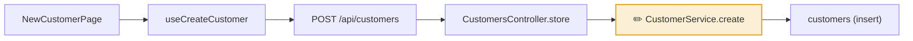

### 🗺 codeloom review map

This PR touches 1 journeys, 1 chains, 1 tables, 0 queues.

| Journey | Changed stops | Spec |
|---|---|---|
| Create a customer | CustomerService.create | unchecked |

Not on any journey:
- `api/lib/gst.ts` (+1/-0)

→ Open the full review map: https://x.github.io/demo/pr-1/ (built for a41c9e2)