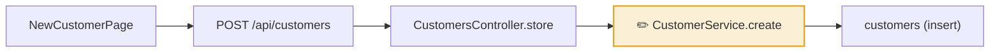

### 🗺 codeloom review map

_Draft by codeloom — not checked._

**What it does:** _(Claude fills this in when it checks the PR.)_

**Where it matters:**
- **Create a customer** — page ` /customers/new ` (web)

**What it writes:** ` customers `

Reads only: ` cities `

**Code to check:**
- ` CustomerService.create ` — changed, +3/-1 (` api/app/services/customer_service.ts `)

Also changed: 2 files — tests, docs

→ Open the full review map: https://x.github.io/demo/pr-1/